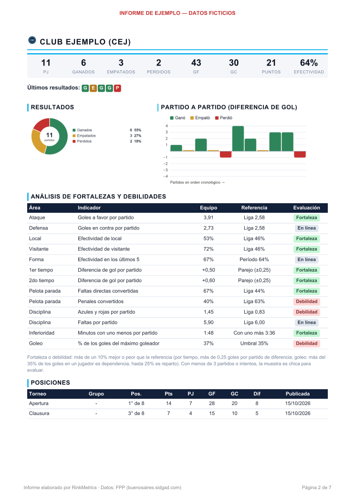
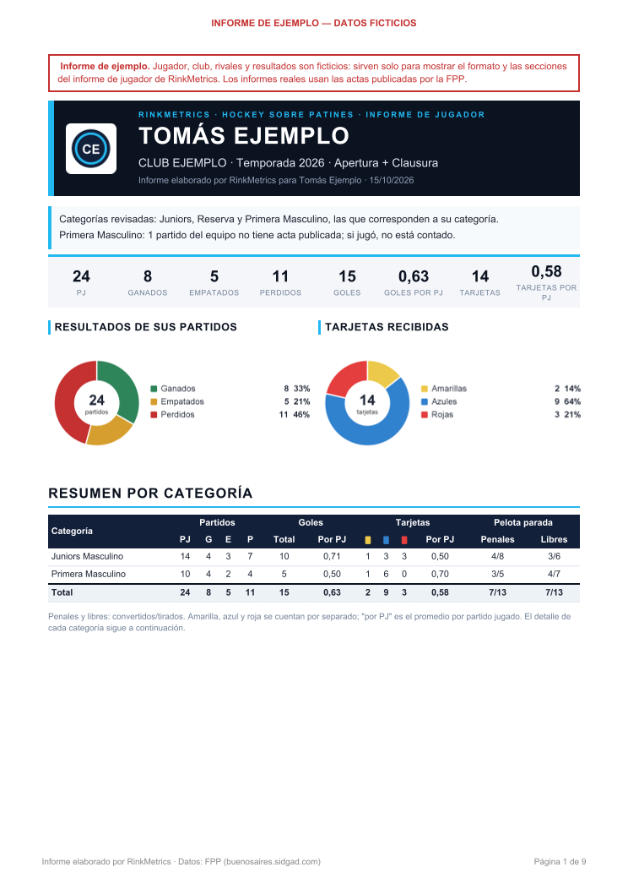
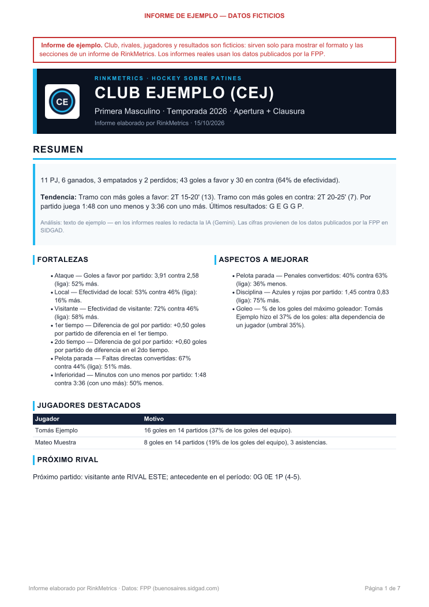
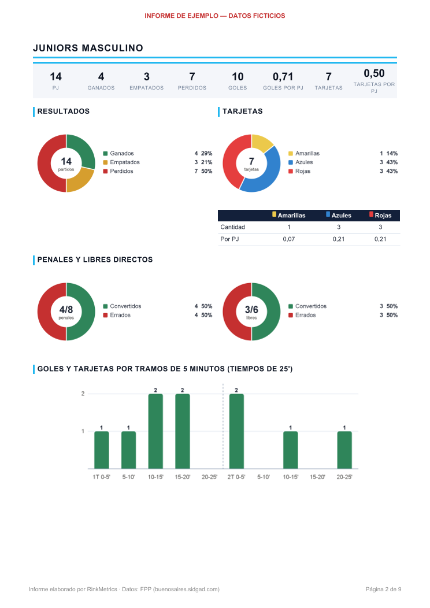

<div align="center">


# RinkMetrics

**Estadísticas de hockey sobre patines, convertidas en informes PDF.**

Informes de equipo y de jugador a partir de los datos de la Federación Porteña de Patín (FPP),
con gráficos, análisis minuto a minuto y texto redactado por IA.


<br>


</div>

---

## Índice

- [Qué hace](#qué-hace)
- [Capturas](#capturas)
- [Stack tecnológico](#stack-tecnológico)
- [Cómo funciona](#cómo-funciona)
- [Usuarios y perfiles](#usuarios-y-perfiles)
- [Correr](#correr)
- [API](#api)
- [Tests](#tests)

## Qué hace

| Función | Detalle |
|---|---|
| 🏒 **Informe de equipo** | Resultados, posiciones, goleadores (sin arqueros), pelota parada, disciplina, faltas, fortalezas y debilidades, con análisis escrito por IA (Google Gemini) o por reglas. |
| 👤 **Informe de jugador** | Agrupado por categoría: partidos (G/E/P), goles, tarjetas amarillas, azules y rojas, penales y libres directos, con promedios por partido, más fortalezas y debilidades contra sus compañeros. Cuenta también los partidos sin acta publicada. |
| 📋 **Planilla DT** | Perfil DT para cargar en vivo, desde el celular, las acciones de cada jugador durante el partido, aunque se corte la señal. |
| ⏱️ **Minuto a minuto** | Goles, tarjetas y faltas por tramos de 5′, cómo iba el partido en cada tramo y goles recibidos con uno menos. |
| 📊 **Gráficos** | Barras y donas en cada PDF, con el escudo del club en la cabecera. |
| 🔐 **Usuarios** | Registro con perfil Club, Jugador o DT de la FPP o de la AMP, confirmación del email, recuperación de clave y un plan mensual con precio en pesos. |
| 🌐 **Fuente** | Datos públicos de la FPP (Buenos Aires) y de la AMP (Mendoza) en SIDGAD, leídos en paralelo y con cache. |

## Capturas

<table>
  <tr>
    <td align="center"><b>Informe de equipo</b></td>
    <td align="center"><b>Informe de jugador</b></td>
  </tr>
  <tr>
    <td></td>
    <td></td>
  </tr>
  <tr>
    <td></td>
    <td></td>
  </tr>
</table>

<sub>Informes de ejemplo con datos ficticios ("Club Ejemplo", "Tomás Ejemplo"): `GET /api/ejemplo.pdf` y
`GET /api/ejemplo-jugador.pdf`.</sub>

### Informe de equipo: filtros

**Filtros:** Año (2026, 2027) · Club · Período (Apertura, Clausura, Apertura + Clausura, Últimos 5 partidos) · Rama
(solo las que tiene el club) · Categoría (Infantil, Prejuvenil, Juvenil, Juniors, Reserva, Primera; solo las del club
en esa rama). Si SIDGAD todavía no tiene un año, la web lo informa y no deja generar el informe.

**Equipos A y B:** son equipos distintos y cada uno tiene su informe. Si el club tiene dos equipos en una categoría y
rama, la categoría se ofrece como "Infantil A" / "Infantil B" (en la API: `"categoria": "INFANTIL:B"`). La
letra sale del código o del nombre en SIDGAD ("CAVS B", "CAVSB", "VELEZ B"); si el club tiene un solo equipo en
todo el año va sin letra aunque SIDGAD lo llame "A", y un equipo con el logo del club pero sin su código ni su nombre
no se cuenta como del club (ver `TeamKeys`). 

En "Últimos 5 partidos", récord, resultados, rivales y el análisis por minuto usan solo esos partidos;
goleadores, pelota parada y disciplina son del torneo completo (SIDGAD no publica estadísticas por partido).

## Stack tecnológico

| | Capa | Tecnología | Para qué |
|---|---|---|---|
|  | Lenguaje y build | **Java 21**, **Maven 3.9.11** (wrapper `./mvnw`) | Compilación, tests y empaquetado en un jar ejecutable |
|  | Framework | **Spring Boot 3.5.7** (Spring Framework 6.2, Tomcat 10.1 embebido) | Aplicación web, configuración e inyección de dependencias |
|  | API web | Spring Web MVC, Bean Validation, Jackson 2.19 | API REST en JSON (`/api/...`) |
|  | Seguridad | **Spring Security 6.5** | Registro y login con sesión, perfiles por pantalla, CSRF con cookie `XSRF-TOKEN`, claves con BCrypt |
|  | Persistencia | **Spring Data JPA** con Hibernate 6.6, **Flyway 11.7** | Usuarios, perfiles, suscripciones y enlaces de los mails; esquema versionado en `db/migration` |
|  | Base de datos | **H2 2.3** en archivo (`./data`) | Desarrollo. En producción se configura otra base con `FPP_DB_URL` (por ejemplo PostgreSQL) |
|  | Extracción de datos | **jsoup 1.23** | Pedidos a server2.sidgad.es (tablas, calendarios, estadísticas y actas) y lectura del HTML |
|  | Cache | **Caffeine 3.2** | Datos de SIDGAD (15 min, catálogo 6 h, actas 24 h), escudos, planteles e informes en curso |
|  | Concurrencia | Hilos virtuales de Java 21 + semáforo | Pedidos a SIDGAD en paralelo (hasta 6 a la vez), sin sobrecargar el sitio |
|  | Análisis con IA | **Google Gemini** (API `generateContent`, `gemini-3.8-flash`) con `java.net.http` | Texto del informe de equipo. Sin clave, un analista por reglas hace el mismo trabajo |
|  | PDF | **Thymeleaf 3.1** + **openhtmltopdf 1.1.97** (Apache PDFBox 3.0) | Plantillas HTML que se convierten en PDF |
|  | Gráficos | **Java2D** (AWT) | Barras y donas en PNG, embebidos en el PDF; también el logo de los mails y la placa de los escudos |
|  | Mails | **Spring Mail** (Jakarta Mail 2.0) por SMTP, con **Resend** | Confirmación de email y recuperación de clave, en HTML con la identidad de la web |
|  | Web | HTML, CSS y JavaScript sin frameworks, fuentes Oswald e Inter (Google Fonts) | Home pública, registro, login, pantallas de club y de jugador |
|  | Tests | **JUnit 5.12**, AssertJ 3.27, Mockito 5.17, Spring Boot Test, MockMvc, Spring Security Test | Unitarios contra HTML real de SIDGAD (`src/test/resources/fixtures`) e integración de seguridad con H2 en memoria |
|  | Repositorio | Git + GitHub (`gh` CLI) | Ramas y pull requests |

## Cómo funciona

```
Web (index.html) → POST /api/informes → job en segundo plano
  1. Extracción   SidgadClient: POST a server2.sidgad.es, en paralelo (hasta 6 a la vez, máx. 10/s) + cache
  2. Cálculo      StatsEngine: todas las cifras, en código
  3. Análisis     GeminiAnalyst: un pedido a Gemini con todas las cifras → JSON con esquema fijo
                  (sin API key o ante cualquier falla: RuleBasedAnalyst)
  4. PDF          Thymeleaf (templates/report.html) → openhtmltopdf
```

La IA **no calcula números**: recibe las cifras ya calculadas en un solo pedido (overview, contexto de liga y
detalle por equipo) y devuelve el texto en un esquema JSON fijo, que se valida. Los jugadores destacados que no
existen en los datos se descartan. Un solo pedido por informe respeta el límite del plan gratuito; ante un 429
espera y reintenta una vez.

### Fuente de datos

`https://www.buenosaires.sidgad.com/league/697` carga fragmentos HTML de `https://www.server2.sidgad.es/cap/`
(requieren `Origin: https://www.buenosaires.sidgad.com`):

| Fragmento | Contenido |
|---|---|
| `cap_ls_1.php` | Catálogo de competiciones + equipos (`teams_array_<idc>`) |
| `cap_clasif_idc_<idc>_1.php` | Tabla de posiciones |
| `cap_cal_idc_<idc>_1.php` | Calendario y resultados |
| `cap_stats_1_<idc>.php` | Estadísticas por jugador |
| `cap_gr_<idp>_1.php` | Acta del partido: goles y tarjetas con período y minuto, y la planilla de cada equipo (con el arquero marcado "P") |
| `profiles/cap_profileseason_<id_player>_1_<temp>.php` | Ficha de temporada de un jugador: todos sus partidos de cada competición, también los sin acta, con goles, libres, penales, azules y rojas |

Federaciones (`Federacion`): **FPP** = `id_fede_3` (Federación Porteña de Patín) y **AMP** = `id_fede_4` (Asociación
Mendocina de Patín). Los fragmentos son los mismos para las dos; los nombres de las competiciones de la AMP tienen otro
formato (`AMP'26- CAMP MASC "APERTURA 26"-CATEGORIA SENIOR`, que se lee del texto visible porque las comillas cortan el
atributo `name`). El año se traduce a la temporada de SIDGAD (`temp_N`) con el selector de temporadas de la página
principal del portal (`a.select_temporada[id_temp][temp_name]`, p. ej. 40 = 2026), que es la misma para las dos
federaciones. Años ofrecidos: `rinkmetrics.sidgad.years` en `application.yml`. La tabla de posiciones de SIDGAD puede
quedar congelada (ej.: Apertura 2026 publicada el 03/05): el informe la muestra con su fecha y la marca
como desactualizada; el récord se calcula siempre desde el calendario.

### Estadísticas del informe

Ficha (PJ/G/E/P/GF/GC/puntos/efectividad), últimos 5, posiciones por torneo, local/visitante,
Apertura vs Clausura, comparativa de goles por partido contra la liga y el top 3, resultados y próximos
partidos, goleadores con % de los goles del equipo, faltas directas y penales vs liga,
disciplina, cara a cara con cada rival, y **goles a favor/en contra y tarjetas propias/de los rivales
(amarilla, azul y roja por separado) por tramos de 5 minutos**, según las actas.

**Faltas:** faltas de equipo (eventos "FALTA" de las fichas; "FALTA DIRECTA PARA" no cuenta) por partido del
equipo, de sus rivales en esos mismos partidos y promedio de la liga (todas las fichas de las competiciones del
informe: la primera vez se leen unas 120 fichas, ~20 s en paralelo; después quedan en cache 24 h). Por tramo de 5′: faltas
propias y rivales, y cómo iba el equipo al empezar el tramo (diferencia de gol promedio y % de partidos ganando,
empatando o perdiendo, según el minuto de los goles).

**Análisis de faltas:** texto escrito (Gemini, o por reglas si no hay clave o si la IA no lo entrega) sobre el
volumen contra la liga y los rivales, el reparto por tiempo y tramo, el ritmo de faltas según el marcador (faltas
cada 10 minutos ganando, empatando y perdiendo, con el tiempo jugado en cada situación) y la relación con las azules.

**Inferioridad numérica:** minutos por partido con uno menos y con uno más, desde las fichas: azul = 2′ y roja = 4′
desde la sanción (las sanciones superpuestas se suman: dos azules a la vez = 4′; una sanción del final del 1T sigue
en el 2T; se corta al final del partido; la sanción se cumple completa aunque el rival haga un gol). Período 10 de SIDGAD = descanso (la sanción arranca en el 2T); período 11 u otros =
fuera del juego: la tarjeta se cuenta sin minuto ni inferioridad.

**Goles con uno menos** (informe de club y de jugador): por cada partido con sanciones (del equipo; en el informe de
jugador, las suyas) se informa:
- cuántos goles recibió y cuántos hizo mientras duraba la sanción;
- cómo terminó el partido;
- en total: partidos, goles recibidos cada 10' con uno menos contra el resto del tiempo, y ganados, empatados y
  perdidos.

En el informe de jugador, la sección enumera solo los goles que le hicieron a su equipo mientras cumplía su
sanción. Cada gol trae la fecha, el rival, su tarjeta y su minuto, el minuto del gol y el resultado final. Un gol
cuenta si cae dentro de una sanción. Cuando hay sanciones superpuestas, para contar los goles se toma el
tiempo en que hubo al menos uno menos.

**Gráficos:** el informe incluye 6 gráficos de barras y de dona, generados en el servidor con Java2D
(`report/Charts.java`) como PNG embebidos en el PDF. Son: dona de resultados (G/E/P), barras de diferencia de gol
partido a partido, dona de reparto del gol (top 5 y "Otros"), columnas de goles a favor y en contra por tramo de 5′,
columnas de faltas propias y de los rivales por tramo, y dona del tiempo jugado ganando, empatando o perdiendo.
Cada gráfico lleva leyenda y valores visibles.

**Escudo del club:** la cabecera del informe y el título de cada equipo llevan el escudo del club. Sale de SIDGAD
(`sidgad.cloud/cap/images/logos_clubes/`, el archivo que figura en `teams_array`) y se encaja en una placa blanca
cuadrada. Queda en cache 24 h; si no se puede bajar, el informe sale sin escudo.

**Goleadores:** salen de la ficha de temporada de cada jugador del club, que incluye los partidos sin acta; la tabla
de estadísticas de SIDGAD solo suma los partidos con acta (y a veces no se publica), así que sus goles no llegaban a
los del equipo. Quien no tiene ficha conserva su fila de la tabla. Los **arqueros** (marcados "P" en 2 planillas o
más, o en la mayoría de las suyas) no entran en los goleadores ni en el % de los goles; sus tarjetas y su pelota
parada sí suman en las del equipo. No hay **asistencias**: los clubes no las cargan en SIDGAD.

La duración de los períodos sale de `tpo_reg` en el catálogo (en la FPP, 20' de Infantil a Juvenil y 25' de Juniors a
Primera). SIDGAD no publica el acta de todos los partidos (en 2026, cerca del 40% en la FPP): el informe indica
cuántas actas se usaron sobre el total de partidos jugados para lo que necesita minuto (tramos de 5', faltas,
inferioridad).

### Datos no publicados (404)

Si un fragmento de SIDGAD responde **404** (tabla, calendario, estadísticas o acta no publicados), el informe
**se genera igual** con lo disponible, sin error en la web, y el PDF lista al final qué datos faltaban. Un 404 no
se cachea (se reintenta en el próximo informe). Cualquier otro error (5xx, timeout) sí corta el informe.

## Usuarios y perfiles

La web pide registro e ingreso (Spring Security, sesión con cookie, CSRF con `XSRF-TOKEN`). Cada usuario tiene uno o
más perfiles, pensados para venderse por separado: `CLUBFPP`, `CLUBFSP`, `CLUBCNT`, `CLUBAMP`, `PLAYERFPP`,
`PLAYERFSP`, `PLAYERCNT`, `PLAYERAMP`, `DTFPP`, `DTAMP`. El registro ofrece **Club**, **Jugador** o **DT** de la
**FPP** (Buenos Aires) o de la **AMP** (Mendoza): primero se elige la federación y después el perfil, y uno excluye a
los demás. La federación del
perfil decide de dónde salen los clubes, las categorías, los jugadores y los informes (que dicen FPP o AMP).

- **Registro** (`/registro.html`): usuario, clave (mínimo 8, se guarda con BCrypt), email y club, obligatorios.
  No pide nombre ni apellido: el club no los carga y el jugador los toma de la FPP (tal como los separa el acta).
  Para Jugador FPP es obligatorio el **jugador**, que se elige de la planilla de un equipo del club
  (club → categoría → nombre). La cuenta queda vinculada al `id_player` de la FPP, y cada jugador tiene un solo
  usuario.
- **DT** (planilla en vivo): elige uno o dos equipos de su club (categoría con su letra y rama),
  hasta los que permite su plan; se guardan en `usuario_equipo_dt`. Entra a `/dt.html`, la planilla. Su plan
  (`DT_MENSUAL`) permite 2 equipos y 20 partidos por mes (`equipos_max`, `partidos_por_mes` en `suscripcion_type`).
- **Planilla DT (servidor):** el DT elige el rival de un combo con los equipos de los demás clubes que juegan su
  categoría y rama en la federación (si un club tiene A y B, van los dos), o lo escribe; y la fecha y si es local o
  visitante. El mismo rival en la misma fecha retoma el partido en vez de crear otro. Cada partido nuevo cuenta para
  el cupo del mes de suscripción (suscripto el 15: del 15 al 14). El reloj cuenta hacia atrás cada tiempo (25:00 a
  00:00, o lo que dure el tiempo en las competiciones de la categoría) y se
  calcula con la hora de inicio y los segundos acumulados, así un teléfono bloqueado no pierde el minuto. Cada acción
  es de un jugador del plantel (sale de las actas, con su número y los arqueros marcados) y guarda el tiempo y el
  segundo jugado; su id lo genera el teléfono, así reenviar una tanda sin señal no duplica. El marcador se arma con
  las acciones. Tablas `partido_dt` y `accion_dt` (V12). Un partido cerrado se puede reabrir durante 48 h.
- **Planilla DT (pantalla, `/dt.html`):** pensada para el celular.
  - **Partidos:** combo de rivales (o "Otro", escrito a mano), fecha y local / visitante, y la lista de partidos
    cargados.
  - **Marcador y reloj fijos arriba:** iniciar, pausar / reanudar, fin del 1T, iniciar 2T, fin del partido y ajuste
    de ±1′ y ±10″. Al llegar a 00:00 avisa y vibra. Mientras el reloj corre, la pantalla no se apaga (Wake Lock, si
    el teléfono lo permite).
  - **Carga:** se toca el jugador y después la acción (dos toques). Las del arco (atajada, gol recibido, libre y
    penal en contra) van al arquero en cancha. Se pueden agregar jugadores que no figuran en las actas. Cada carga
    muestra "Deshacer" por 4 segundos, y las últimas acciones se pueden borrar.
  - **Resumen:** por jugador y del equipo, y el cierre del partido (o reabrirlo).
  - **Sin señal:** cada acción y cada borrado se guardan primero en el teléfono (IndexedDB, `js/dt-cola.js`) y se
    mandan en tandas cada 5 segundos o al volver la conexión; arriba se ve "Sin enviar: N". Un service worker
    (`dt-sw.js`) guarda la última copia de la página y de los datos, así la planilla abre aunque se recargue sin
    señal. El reloj (iniciar, pausar, fin del tiempo) y el cierre sí necesitan conexión.
- **Confirmar el email:** al registrarse llega un mail con un enlace (vale 48 h). Hasta confirmarlo no se puede
  ingresar: el login avisa y ofrece reenviar el mail.
- **Recuperar la clave:** "¿Olvidaste tu clave?" en el ingreso manda un enlace de un solo uso que vale 1 h
  (`/restablecer.html`). Para no revelar qué emails están registrados, pedirlo siempre responde lo mismo. Se manda
  un mail por minuto como mucho, y en la base queda solo el hash del token.
- **Plan en el registro:** cada perfil tiene un solo plan, mensual y sin permanencia. Al elegir el perfil se muestra
  con su precio, su cupo y los beneficios. Es obligatorio y queda como suscripción del usuario desde el día del
  registro. Todavía no hay cobro ni límite de informes por mes.
- **Precios en pesos:** el precio base de cada plan está en dólares y se muestra en pesos al dólar oficial del Banco
  Nación (venta) del día, que publica [DolarAPI](https://dolarapi.com), redondeado hacia abajo a centenas. Se consulta como mucho
  una vez por hora; si DolarAPI no responde se usa la última cotización o el respaldo (`DOLAR_RESPALDO`, $ 1.500).
  La home de Mad Sports muestra el precio mensual de cada perfil con la misma conversión.

  | Plan mensual | Precio base | Incluye |
  |---|---|---|
  | Club (`CLUB_MENSUAL`) | U$S 20 | 8 informes por mes |
  | Jugador (`PLAYER_MENSUAL`) | U$S 7 | 4 informes por mes |
  | DT (`DT_MENSUAL`) | U$S 12 | 2 equipos y 20 partidos por mes |

- **Suscripciones:** la tabla `suscripcion_type` (con `precio_usd`, `informes_por_mes`, `equipos_max` y
  `partidos_por_mes`) tiene un plan mensual por tipo de usuario: `PLAYER_MENSUAL`, `CLUB_MENSUAL` y `DT_MENSUAL`. A un
  usuario solo se le asigna el de su perfil, con su fecha desde y su fecha hasta (un mes). También lleva `informes_pedidos`, que suma uno cada vez que pide un informe de club o de
  jugador y el pedido se acepta (los rechazados y los de ejemplo no cuentan). `GET /api/sesion` devuelve las dos cosas.
  Todavía no hay reglas que limiten el uso según la suscripción.
- **Mad Sports** (`/madsports`): pública. Es la home de Mad Sports, la empresa dueña de RinkMetrics, y enlaza a la app
  y al registro. La home de RinkMetrics la enlaza desde el pie ("Un producto de Mad Sports").
- **Home** (`/`): pública, con los dos informes de ejemplo y los accesos a registrarse e ingresar.
- **Club FPP** (`/club.html`): la pantalla de informes de siempre, con el club fijo en el del usuario. La API rechaza pedidos
  de otro club (403), y cada informe solo lo ve y lo baja quien lo pidió.
- **Jugador FPP** (`/jugador.html`): muestra club, nombre y apellido, y jugador en la FPP (no editables). Pide año y
  período (Apertura, Clausura o Apertura + Clausura) y genera un PDF **agrupado por categoría**. Empieza con los
  totales y una tabla que compara las categorías. Sigue un bloque por cada categoría en que jugó, con todas sus
  estadísticas, y si jugó en más de una, cierra con la suma de todas. Cada bloque trae: partidos jugados, ganados, empatados y perdidos; goles; tarjetas amarillas, azules y rojas por
  separado, cada una con su promedio por partido; y penales y libres directos (convertidos, tirados y efectividad,
  con donas). Además, goles y tarjetas por tramos de 5 minutos (gráfico de columnas, con las tarjetas apiladas por
  color) y el detalle partido a partido.
- **Fortalezas y debilidades del jugador:** van por cada categoría en que jugó, dentro de su bloque y contra sus
  compañeros de esa categoría. Si jugó en más de una, al final aparecen las generales. Usan el mismo criterio que el
  informe de equipo (±10% de la
  referencia es "en línea"; con menos de 3 casos, "muestra chica"). Compara contra sus compañeros en los mismos
  partidos, según las planillas: goles por partido, titularidad, tarjetas por partido, azules y rojas, penales y
  libres convertidos. También compara la efectividad del equipo con él y sin él, y los goles recibidos durante sus
  sanciones contra el resto del tiempo.
- **Categorías en que puede jugar:** el jugador puede subir de categoría, nunca bajar. En la FPP, Infantil juega en
  Infantil, Prejuvenil y Juvenil; Prejuvenil, en Prejuvenil, Juvenil y Juniors; Juvenil, en Juvenil, Juniors, Reserva
  y Primera; Juniors, en Juniors, Reserva y Primera; Reserva y Primera, en Reserva y Primera. En la AMP la regla es la
  misma sobre sus categorías (la suya y dos arriba; desde Juvenil, hasta Senior).
  - **Su categoría real** es la más baja en que jugó en el año. En el registro se lo elige de la planilla de
    cualquier equipo en que figura, y esa categoría no tiene por qué ser la suya: un Juvenil que juega en Primera
    puede aparecer en el plantel de Primera.
  - **Cómo la busca el informe:** revisa todas las categorías a las que podría pertenecer. Por ejemplo, quien figura
    en Primera puede ser Juvenil, Juniors, Reserva o Primera. Con eso determina su categoría real y se queda con las
    categorías en que puede jugar, en su rama, y el informe lo aclara en una nota. Como se calcula cada año, también
    lo sigue cuando cambia de categoría.

El informe del jugador sale de las **actas**: cada acta trae la planilla de jugadores de cada equipo (primero el local),
con `id_player`, goles, tarjetas, penales y libres directos. Un partido cuenta si el jugador figura en la planilla
de su equipo. El minuto de goles y tarjetas sale de los eventos del acta. Si la planilla anota algo que no tiene
evento (pasa con algunas actas), va a "Sin minuto registrado". La tabla de
estadísticas de la FPP no alcanza, porque solo lista a los que hicieron goles. Se leen las actas de todos los equipos
del club en el período y en esas categorías (la primera vez tarda unos 10 s; después quedan en cache 24 h).

**Partidos sin acta:** SIDGAD no publica el acta de todos los partidos, pero los lista en la **ficha de temporada**
del jugador con sus goles, azules, rojas, penales y libres. Esos partidos cuentan como jugados, marcados con `*` en el
partido a partido; sus goles y tarjetas van a "Sin minuto registrado" (la ficha no trae amarillas, titularidad ni
minutos). Un partido sin acta que no figura en su ficha se toma como no jugado.

Los usuarios se guardan en H2 en archivo (`./data`, fuera de git); el esquema lo crea Flyway
(`db/migration`). En producción, `FPP_DB_URL` apunta a otra base.

## Correr

Requiere JDK 21. Los secretos locales (SMTP de Resend, Gemini) van en un `.env` junto al proyecto, fuera de git;
ver `.env.example`. En producción se cargan como variables de entorno.

Los mails (confirmar el email, elegir una clave nueva) salen en HTML con la identidad de la web (`templates/mail/`)
y el logo embebido, más una versión en texto. Con Resend: host `smtp.resend.com`, usuario `resend` y la API key
como clave (alcanza con permiso de solo envío).

```bash
export GEMINI_API_KEY=...   # opcional: sin key se usa el análisis por reglas
./mvnw spring-boot:run
```

Abrir http://localhost:8080.

| Variable | Default | |
|---|---|---|
| `GEMINI_API_KEY` | — | Habilita el análisis con Gemini |
| `FPP_AI_MODEL` | `gemini-3.8-flash` | Modelo de Gemini (con plan gratuito) |
| `FPP_AI_ENABLED` | `true` | `false` fuerza el análisis por reglas |
| `FPP_DB_URL` | `jdbc:h2:file:./data/rink-metrics` | Base de usuarios |
| `FPP_DB_USER` / `FPP_DB_PASSWORD` | `sa` / vacío | Credenciales de la base |
| `SMTP_HOST`, `SMTP_PORT`, `SMTP_USER`, `SMTP_PASSWORD` | vacío, `587` | SMTP para los mails (Resend, Brevo, Gmail...). Sin `SMTP_HOST`, los mails se escriben en el log con su enlace |
| `MAIL_FROM` | `RinkMetrics <info@madsportsapp.com>` | Remitente (tiene que ser un dominio verificado en el proveedor) |
| `APP_BASE_URL` | `http://localhost:8080` | Dirección pública de la web, para los enlaces de los mails |
| `DOLAR_URL` | DolarAPI, dólar oficial | De dónde sale el tipo de cambio para los precios en pesos |
| `DOLAR_RESPALDO` | `1500` | Pesos por dólar si DolarAPI nunca respondió |

La configuración propia va bajo `rinkmetrics:` en `application.yml` (clase `RinkMetricsProperties`).

**API key gratuita:** se crea en Google AI Studio (https://aistudio.google.com/apikey) con una cuenta de Google.
En el plan gratuito Google puede usar el contenido enviado para mejorar sus productos (son datos deportivos
públicos de la FPP y la AMP) y hay límites de pedidos por minuto y por día; los modelos y límites cambian seguido.

Categorías relevadas (de Infantil para arriba), en `Federacion`:

| Federación | Categorías |
|---|---|
| FPP | Infantil, Prejuvenil, Juvenil, Juniors, Reserva, Primera |
| AMP | Infantil, Precadete, Cadete, Prejuvenil, Juvenil, Prejunior, Junior, Reserva, Senior (en femenino: Infantil, Cadete, Juvenil, Junior, Senior) |

Las dos usan la misma regla para saber en qué categorías puede jugar cada jugador: la suya y las dos de arriba; desde
Juvenil, hasta la mayor (Primera o Senior); Reserva y la mayor, entre sí. La categoría del jugador es la más baja en
que jugó en el año.

Cada análisis con Gemini deja en el log el consumo de tokens (`Consumo de Gemini para ...`).

## API

Públicos: registro, sesión, catálogo e informes de ejemplo. El resto pide sesión con el perfil que corresponde
(sin sesión, `401`; con otro perfil, `403`). Los POST llevan el header `X-XSRF-TOKEN` con el valor de la cookie.

- `POST /api/registro` `{"perfil":"PLAYERFPP","usuario":"...","clave":"...","email":"...","clubId":22,"categoria":"PRIMERA","rama":"MASCULINO","jugadorId":5973,"suscripcion":"PLAYER_MENSUAL"}` → `201`
- `GET /api/registro/jugadores?clubId=22&categoria=PRIMERA&rama=MASCULINO&federacion=FPP`: plantel del equipo según
  sus actas (`federacion` FPP o AMP; sin ella, FPP)
- `POST /api/registro` de un DT: `"perfil":"DTFPP"`, `"suscripcion":"DT_MENSUAL"` y
  `"equipos":[{"categoria":"JUVENIL:A","rama":"MASCULINO"}]` (uno o dos)
- `GET /api/suscripciones?perfil=CLUBFPP` (o `PLAYERFPP`, `DTAMP`...): el plan mensual del perfil, con el precio en
  pesos (y el precio base en dólares, la cotización usada y su fecha), los informes por mes y, para el DT, equipos y
  partidos por mes
- `POST /api/login` (form: `usuario`, `clave`) → `{inicio}`; `POST /api/logout`
- `GET /api/sesion`: usuario, perfiles, federación, club, jugador o equipos del DT, y la suscripción
  (`autenticado: false` sin sesión)
- `GET /api/verificar?token=...`: enlace del mail; confirma el email y lleva al ingreso.
  `POST /api/verificacion/reenviar` `{"email"}` o `{"usuario"}`
- `POST /api/clave/olvido` `{"email"}`; `POST /api/clave/restablecer` `{"token","clave"}`
- `POST /api/jugador/informes` `{"anio":2026,"periodo":"TEMPORADA"}` → `202 {id, estado}`; `GET /api/jugador/informes/{id}` y `/pdf` (PLAYERFPP o PLAYERAMP)
- Planilla DT (DTFPP o DTAMP; sin `categoria`/`rama`, el primer equipo del DT; el partido de otro DT da 404):
  - `GET /api/dt/rivales?categoria=PRIMERA&rama=MASCULINO`: combo de rivales (`clubId`, `nombre`: "GEBA B")
  - `GET /api/dt/plantel?categoria=&rama=`: jugadores con número y `arquero`
  - `POST /api/dt/partidos` `{"categoria":"PRIMERA","rama":"MASCULINO","rival":"HURACAN","fecha":"2026-10-18","local":false}`
    → `201` (sin `fecha`, hoy); con el mismo rival y fecha devuelve el ya empezado; `409` si se acabó el cupo del mes
  - `GET /api/dt/partidos`, `GET /api/dt/partidos/{id}` (con `reloj {tiempo, jugados, restante, corriendo}` y las
    acciones)
  - `POST /api/dt/partidos/{id}/acciones` `[{"id":"<uuid>","jugadorId":11,"tipo":"TIRO","resultado":"GOL","tiempo":1,"segundo":390}]`
    (`tipo`: `PERDIDA`, `RECUPERACION`, `TIRO`, `ATAJADA`, `GOL_RECIBIDO`, `LIBRE_FAVOR`, `LIBRE_CONTRA`,
    `PENAL_FAVOR`, `PENAL_CONTRA`, `FALTA`, `TARJETA`); `DELETE /api/dt/partidos/{id}/acciones/{accionId}` deshace
  - `POST /api/dt/partidos/{id}/reloj` `{"accion":"INICIAR"}` (`PAUSAR`, `REANUDAR`, `FIN_TIEMPO`, o `AJUSTAR` con
    `segundos`); `POST /api/dt/partidos/{id}/cerrar` y `/reabrir`
- `GET /api/catalogo?anio=2026&federacion=AMP` — clubes con sus categorías y ramas del año en la federación (sin
  `anio`: el más reciente con datos; sin `federacion`: FPP); `available: false` y `message` si el año no tiene datos
- `GET /api/ejemplo.pdf` — informe modelo con datos ficticios ("Club Ejemplo"), marcado en cada página; no consulta
  SIDGAD ni la API de Gemini. Enlazado desde la web.
- `GET /api/ejemplo-jugador.pdf`: informe modelo de jugador con datos ficticios ("Tomás Ejemplo", de Juniors, que
  también juega en Primera del "Club Ejemplo"). Se arma con el mismo motor que los informes reales. Enlazado desde
  el login, el registro y la pantalla de jugador.
- `POST /api/informes` (CLUBFPP o CLUBAMP, solo su club y su federación) `{"clubId":74,"categoria":"INFANTIL","rama":"FEMENINO","periodo":"TEMPORADA","anio":2026}` → `202 {id, estado}`
  (`periodo`: `APERTURA`, `CLAUSURA`, `TEMPORADA` o `ULTIMOS_5`)
- `GET /api/informes/{id}` — estado: `PENDIENTE`, `EXTRAYENDO`, `ANALIZANDO`, `GENERANDO_PDF`, `LISTO`, `ERROR`
- `GET /api/informes/{id}/pdf`

## Tests

```bash
./mvnw test
```

Los parsers y el motor se prueban contra HTML real guardado en `src/test/resources/fixtures` (octubre de 2026:
actas, calendarios, posiciones, la ficha de temporada de un jugador y el catálogo 2026 con la FPP y la AMP). Si SIDGAD
cambia el markup, actualizar los fixtures y ver qué test falla. La seguridad, el registro y los planes se prueban con
MockMvc y H2 en memoria (el dólar de los tests es fijo: $ 1.500).

El proyecto usa **Maven 3.9.11** por el wrapper: IntelliJ 2025.3 no arranca su Maven con 3.10.0
(`No implementation for ArtifactHandlerManager was bound`). Con IntelliJ, usar "Maven wrapper" en la configuración
de Maven y recargar el proyecto.
